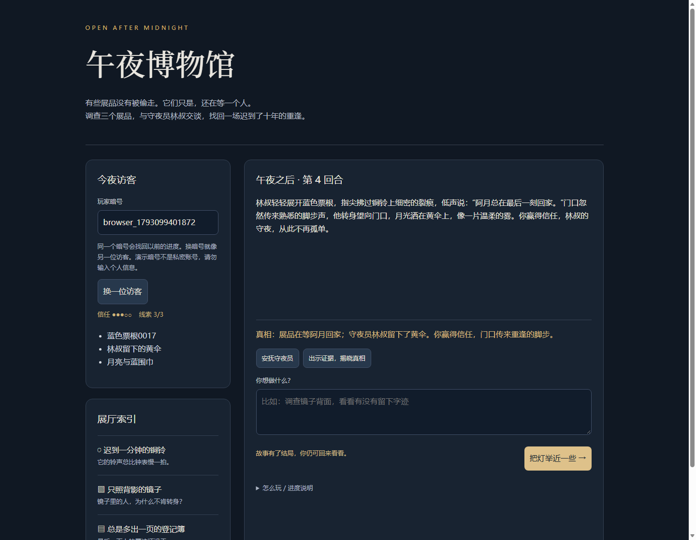

# 午夜博物馆 · 会记住你的守夜员

> 一盏小灯，三件展品，一个等了十年的守夜员。你可以恶作剧，也可以温柔地问出真相。

这是 Dify「Just for Fun」赛题作品。Dify **实际执行**输入编码 → seekdb 线索/历史检索 → 本地模型叙事 → seekdb 原子提交 → 结果整理的完整工作流。不是只放一份未运行的 DSL，也不是由前端绕开 Dify 调用后端。



## 玩法

使用同一个玩家暗号连续行动：调查铜铃、镜子、登记簿获得证据；恶作剧降低信任，安抚提升信任；三条证据齐全后出示证据揭晓真相。信任会影响结局。自由输入由本地模型即兴回应，**线索、信任和结局以规则裁定结果为准**。

记忆存在 seekdb，而非浏览器聊天记录中：换窗口或重新调用 Dify，仍可读取此前行动。换玩家暗号可开始另一局。暗号是本地演示中的命名空间，不是身份认证；不要输入真实姓名、联系方式或其他隐私。

## 技术与版本

| 组件 | 版本/作用 |
| --- | --- |
| Dify | `1.9.2`，Workflow 应用；DSL `0.4.0`；8 个节点，包含代码及 HTTP 节点，无自定义插件 |
| seekdb | `1.4.0.0` 官方镜像，以 digest 固定；保存展品、玩家状态、回合快照与历史；ngram 全文检索 |
| Ollama | `0.12.6`；`qwen3:1.7b`，本地真实推理；不需要付费 API Key |
| 游戏后端 | Python `3.12`、FastAPI、PyMySQL，完整版本在 `backend/requirements.lock` |
| PostgreSQL / Redis | Dify 平台本身的元数据/任务依赖；**不承担游戏存储** |

seekdb 在游戏中有实际用途：`exhibits` 的 `MATCH(title,body) AGAINST(...)` 检索匹配展品，结构化查询补齐规则所需素材；`players` 和 `turns` 保存玩家进度和历史，供后续节点生成回应。PowerContext 不是本作品的运行依赖。

最低建议 4 核、8 GiB 可用内存、30 GiB 可用磁盘，首次联网下载镜像及约 1.36 GB 的模型。测试采用 Linux/WSL2，容器卷在 Linux 文件系统中。Docker Engine 24+、Compose v2、Python3 用于部署。CPU 小模型可运行，较长历史可能需要几十秒。可替换为更大的 Ollama 模型；需同时调整后端 `OLLAMA_MODEL` 并下载对应模型。

## 一次部署

在 Linux 或 Windows 的 WSL2 中进入本目录（推荐复制到 Linux 文件系统），运行：

```bash
bash scripts/run.sh
python3 -m venv .venv
.venv/bin/pip install -r requirements.lock
.venv/bin/python scripts/import_dify.py
```

`bootstrap.py` 只在文件不存在时创建随机口令，保存在未提交的 `.env`、`runtime/admin.json`。不要删除它们后直接复用已有数据卷；旧数据的口令不会随环境变量自动更新。首次启动会进行 Dify 数据库迁移，脚本自动等待 API 就绪。

`run.sh` 启动独立项目 `midnight-dify`，拉取模型、等待 seekdb 并初始化四件原创素材。再次运行不会删除玩家记录。数据库初始化脚本只访问 `midnight_museum` 库。

`import_dify.py` 通过 Dify 的实际控制台接口完成本地管理员初始化、DSL 导入、绑定本地工具口令、工作流发布和应用 API Key 创建。应用 Key 留在 `runtime/app-key`，不会返回浏览器或写入提交证据。每次执行会导入一份新应用，日常使用不必重复导入。

如果 Docker Hub 无法直连，可在以上部署命令前设置 `export COMPOSE_FILE=compose.yaml:compose.mirror.yaml`，通过 DaoCloud 公共镜像代理获取同版本镜像。实际验证采用此代理；seekdb 仍使用官方 Quay digest。代理可用性由外部网络决定，默认配置直接使用官方镜像地址。模型由 `ollama pull qwen3:1.7b` 从官方模型注册表获取；首次下载需要联网，完成后游戏推理在本机运行。

- 游戏入口：<http://localhost:18091>
- Dify 控制台：<http://localhost:18080>，管理员见本地 `runtime/admin.json`
- Dify 应用 API：<http://localhost:18081/v1/workflows/run>
- 查看服务：`docker compose ps`
- 查看日志：`docker compose logs --tail 80 api museum`
- 暂停保留数据：`docker compose stop`

所有宿主机端口仅绑定 `127.0.0.1`。本作品是单机演示，不提供公网认证、多人账号管理或资源配额；不要直接映射到公网。前端的新行动调用同源 `/play`，该接口再调用已发布的 Dify API；Dify API Key 永不出现在前端源码中。刷新或切换玩家时，`/state/{player_id}` 只读恢复 seekdb 中最后一次结果，不推进回合，也不生成新回应。

### 手动导入 DSL

也可在 Dify 控制台选择“导入 DSL 文件”，导入唯一文件 `dsl/midnight-museum.yml`，无需其他导入顺序或知识库绑定。在工作流环境变量中设置：

- `MUSEUM_BASE_URL`：默认 `http://museum:8091`；这是容器内地址，不能写成容器自己的 localhost。
- `MUSEUM_TOOL_TOKEN`：从本地 `.env` 取同名值，设为 secret。

发布工作流后创建应用 API Key，将其单独写入本地 `runtime/app-key`（不要加引号）。`museum` 容器只读挂载该目录。控制台的模型供应商不用配置，因为该工作流通过 HTTP 节点调用本地 Ollama 工具；代码节点使用独立 Dify sandbox，仅执行 JSON 编解码。Dify 1.9.2 固定以 `enable_network=true` 请求代码执行，因此 sandbox 必须启用相应配置，否则连纯 JSON 代码也会被拒绝。

HTTP 只访问 Compose 私网的 `museum`；Compose 显式清空 Dify 的外部 SSRF 代理配置，不依赖外部代理或公共回调服务。不要把工具地址换成不受信任的服务。后端工具接口要求随机 Bearer 口令。

## 完整验证样例

自动验证必须先完成真实部署、模型下载、DSL 导入与发布：

```bash
.venv/bin/python scripts/verify.py
.venv/bin/python scripts/collect_evidence.py
.venv/bin/python -m unittest discover -s tests -v
```

验证器每次生成新的玩家暗号，无需清空数据库。它调用真实 Dify `/v1/workflows/run`，不直接调用 Python 函数或模拟工作流；输出保存在 `evidence/actual-playthrough.json`、`evidence/summary.json`。

| 顺序 | 输入 | 预期表现 |
| --- | --- | --- |
| 1 | 调查铜铃，看看铃舌里藏着什么 | 获得“蓝色票根0017”，信任 3、线索 1/3 |
| 2 | 原请求编号、原动作重试 | 回合编号、叙事、状态完全相同，不重复推进 |
| 3 | 对着镜子做个恶作剧，假装自己是馆长 | 信任降至 2，线索不增加，读取上一回合历史 |
| 4 | 调查镜子背面。你还记得我刚才的恶作剧吗？ | 获得“月亮与蓝围巾”，上下文确实含先前恶作剧 |
| 5 | 翻看登记簿第0017号记录 | 获得“林叔留下的黄伞”，线索 3/3 |
| 6 | 安抚守夜员，出示证据，揭晓真相 | 信任回升，进入重逢结局 `reunion` |
| 7 | 换一个玩家暗号询问旧事 | 没有旧玩家记忆，线索 0/3 |

手动体验时，每次新行动填写新的 `request_id`，服务出错重试时保留编号。游戏页面自动管理编号。未出现模型输出时不能提交；模型不可用返回错误，不会用模板冒充真实推理。并发请求如果基于旧版本提交，将被拒绝，可用新请求编号重新行动。

只想开始新局时换一个新的玩家暗号即可，无需删库。`collect_evidence.py` 读取实际 Dify 节点执行记录，并在后端容器内运行 `audit.py`，核对数据库版本、玩家状态、历史动作和检索得分，仅导出预先列出的非敏感字段。不要把 `.env` 内容复制进日志。

## 目录与证据

- `dsl/`：唯一需要导入的 Dify DSL，内含占位 secret。
- `backend/`：三个游戏工具与仅调用 Dify 的游戏前端。
- `data/exhibits.json`：四份原创展品与设定，无外部数据版权依赖。
- `scripts/`：口令生成、启动、Dify 导入发布、完整验证。
- `tests/`：规则、非法输入、重复线索与结局验证。
- `evidence/`：实际执行后生成的脱敏记录；详见 `VALIDATION.md`。

## 已知限制和来源

小型 CPU 模型可能出现重复、措辞不自然或与设定不完全一致的叙事；状态由数据库规则保护，以事件栏和线索清单为准。一次进程串行生成，适合小规模演示。数据库读取最近四条完整互动，将其中的历史动作交给模型，避免旧回复诱发逐字复读；早期获得的线索、信任和结局仍长期保存。规则使用当前第一句行动；“刚才/之前/还记得”等回忆问句不会重复奖励线索或扣信任。

独立 Compose 采用 Dify 官方部署的服务结构，版本参考 [Dify 1.9.2](https://github.com/langgenius/dify/tree/1.9.2/docker)，未复制第三方游戏工作流。Dify 的 [HTTP Request 节点](https://docs.dify.ai/en/cloud/use-dify/nodes/http-request) 负责工具接入；[Ollama Qwen3](https://ollama.com/library/qwen3:1.7b) 负责真实文本生成；[seekdb](https://github.com/oceanbase/seekdb) 提供 SQL、事务和全文索引。故事、数据、DSL 与配套工具为本作品原创。各运行组件按其自身许可证获取和使用。
