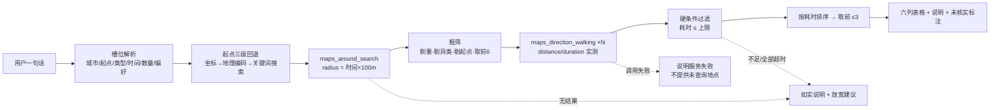

# 周边去哪儿：基于高德的地点推荐助手

针对 [高德开放平台 × OceanBase 赛题](https://oceanbase.yuque.com/org-wiki-obtech-vh7w9r/hc3pio/qp60miwsbk1mcgod) 实现。
基于 `oceanbase/powercontext` 的 `2026-competition-ecosystem` 分支（基础提交 `d647275`），
所有作品资产位于 `gaode/`，开发分支 `feat/gaode-nearby-skill`。

**提交产物只有一个文件：[`SKILL.md`](./SKILL.md)。** 题面明确只需向提测平台上传该 Skill 文件，
运行环境、模型与高德 MCP 配置由平台提供，因此本作品不附带源码、脚本、测试报告或 API Key。
本目录下其余文档仅供人工复核与自检，不参与评测。

## 一、交付内容

| 文件 | 作用 | 是否提交评测 |
| --- | --- | --- |
| `SKILL.md` | 周边探索 Skill 本体：需求解析、工具调用、筛选排序、回答格式、异常处理、禁止清单、范例、自检表 | ✅ 唯一提交物 |
| `README.md` | 设计说明与自检结论 | 否 |
| `EVAL.md` | 四类评测场景的逐条走查（普通推荐 / 时间限制 / 偏好排序 / 结果不足与异常） | 否 |
| `scripts/check_skill.py` | 对 `SKILL.md` 的静态校验：结构完整性、无密钥、工具名白名单、表格列数、禁止项覆盖 | 否 |

## 二、Skill 是怎么把 20 分拆成可执行动作的

评分权重是数据真实性 40% + 需求满足 30% + 推荐合理性 20% + 表达清晰度 10%。
Skill 的每一条规则都对应其中一个扣分点，而不是泛泛的"请推荐附近地点"：

| 评分维度 | 对应机制 | 落在 SKILL.md 的位置 |
| --- | --- | --- |
| 数据真实性 40% | 所有距离/时间必须取自 `maps_direction_walking` 的 `distance/duration`；给出单位换算与 `distance/duration≈1.2` 的交叉校验；禁止直线距离替代；地址为空走 `maps_search_detail` 补全，最多 3 条 | §4 P3、§5、§8-2 |
| 需求满足 30% | 时间上限是**硬闸门**（P4 先过滤后排序）；数量硬上限 3；超时项只能进"超出上限的备选"文字段，不进表 | §4 P4、§6 写法要求 |
| 推荐合理性 20% | 先按 `type` 剔异类、按 id 剔重、剔起点自身；排序与真实耗时严格一致；"最近"这类相对描述不得与顺序矛盾；无评分数据不许编造分数 | §4 P2/P4、§7 |
| 表达清晰度 10% | 固定六列表格 + 不超过 4 行说明；理由一句话且挂靠数据；缺失信息标"未核实" | §6 |

三个针对本题已知陷阱的专门设计：

1. **坐标顺序陷阱**。高德要求 `"经度,纬度"`，而用户/上游常给 `"纬度,经度"`。
   Skill 用地理范围判序（经度 73–136、纬度 18–54，超出则交换），避免整轮结果偏移到地球另一侧。
2. **半径 vs 实测的区分**。半径只用于召回，`radius = time_limit × 100 米`（步行 80 米/分 × 1.25 路网绕行系数），
   是否达标一律看实测耗时。既避免了"小半径漏召回"，也避免了"用直线距离冒充步行距离"。
3. **单轮不追问**。评测是单轮任务，Skill 明确规定条件缺失时用默认值（15 分钟 / 3 家 / 耗时升序）
   并在一行内注明假设，而不是反问用户，保证任何输入都能产出可评分的回答。

## 三、执行路径（一次任务的实际调用序列）



调用预算：整轮 ≤ 12 次（搜索 ≤2、路线 ≤6、详情 ≤3、地理编码 ≤1）。首次候选不足时才允许扩大半径一次，
避免在评测时间窗内反复试探。

## 四、已知限制（如实记录，不粉饰）

1. **未做真机联网验证**。本机没有高德 Web 服务 Key，Skill 中的调用流程与字段名依据高德开放平台
   [MCP Server 文档](https://lbs.amap.com/api/mcp-server/) 编写，未在真实 Key 下跑通端到端用例。
   因此 `SKILL.md` 里不写死任何一次具体调用的成功前提，而是给出字段缺失、单位异常、结构差异的降级规则。
2. **工具名存在多版本差异**。官方 MCP 与若干社区实现分别使用 `maps_around_search / maps_direction_walking`
   与带服务器前缀的变体，部分版本步行规划拒绝超过 100km 的起终点。Skill 按**能力语义**匹配工具，
   按后缀名兜底，并明确"不要自造工具名"。
3. **`duration` 单位在不同实现下可能是秒或分钟**。Skill 用 `distance/duration` 比值落在 0.8–1.6 米/秒
   来判断单位，而不是假定。这是静态规则，仍需真实返回样本验证。
4. **营业状态、排队、评分、人均不在高德 MCP 的稳定返回字段里**。Skill 的选择是标注"未核实"而不是回避提问，
   代价是回答的信息量受限，但符合"未经数据支持的描述不能作为加分依据"的规则。

## 五、自检

```bash
python scripts/check_skill.py
```

校验项见脚本文件头注释：frontmatter 可解析、题目要求的四类信息（名称用途场景 / 工具步骤 / 回答格式 / 异常处理）
均有对应章节、无密钥与占位符残留、工具名全部在白名单内、范例表格列数与模板一致、禁止清单覆盖题面明令的
四条硬约束。脚本仅做静态检查，不替代平台的真机评测。
