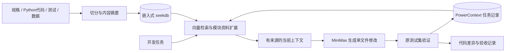

# 一页技术说明：SDD 工程上下文与任务恢复

业务目标是为订单列表实现精确状态筛选，并保留排序、分页、参数校验和输入不变性。
模块以 CLI 接收任务和工程来源清单，输出可定位的规格、代码、测试及已保存进度。

**检索方式。** Markdown 按条款、Python 按顶层符号切分，并保留完整来源文件。
每条记录包含工程、模块、种类、文件路径、行号、符号和 SHA-256。
使用 128 维本地哈希词向量，显式向 seekdb 写入 embeddings、documents 和 metadatas。
任务查询由 seekdb 执行向量检索；依据命中的模块再通过数据库过滤读取规格、代码、测试和数据。
输出前检查实际文件存在且内容摘要相符。规格更改必须重新导入；清单移除的来源同步删除。
写入后刷新 seekdb 异步索引，重启时刷新后查询，保证小样例可立即读取。

**技术分工。** seekdb 负责真实工程资料和索引的持久化与查询。
PowerContext 1.4.0 的 `open_builtin_runtime`、`scopes.create`、`sources.capture` 和
`records.list_sources` 负责任务状态保存和重启读取，持久化后端为其内置 SQLite。
每个任务拥有独立 Scope，最新 Source 由 journal position 选择；新上下文实际包含恢复记录。
MiniMax 通过官方兼容 HTTP API 接收这份上下文，只可生成指定的订单服务文件。
模型产物通过不变的业务测试后才进入交付源码，保存请求、响应标识、用量和修改摘要。

**设计取舍。** 独立数据库服务可支持多用户，但增加评审部署成本；纯文件检索无法满足数据库实际参与要求。
本作品采用嵌入式 seekdb 与进程内 PowerContext，降低部署步骤并保留两项技术的真实调用。
未引入完整 Agent 框架，单次受限编辑足以验证“上下文→修改→测试→状态复用”的流程。

**验证。** 一个原始快照与一个修改后快照共享同一测试集。原始代码的目标失败必须来自行为断言；
修改后目标测试和原有回归测试须全部通过。另验证当前来源、规格重新导入、过期拒绝和独立进程状态复用。
所有命令、退出码与源码摘要保存在 `evidence/`；MiniMax 参与状态独立核对，缺少真实调用不能判为全项通过。
